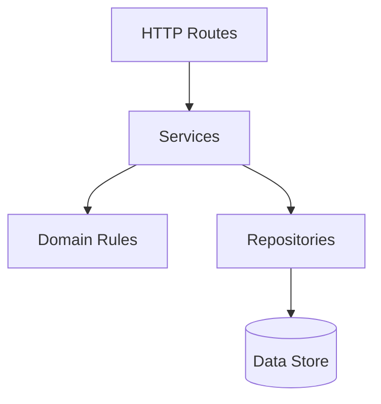
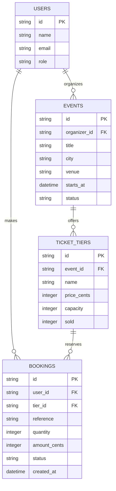
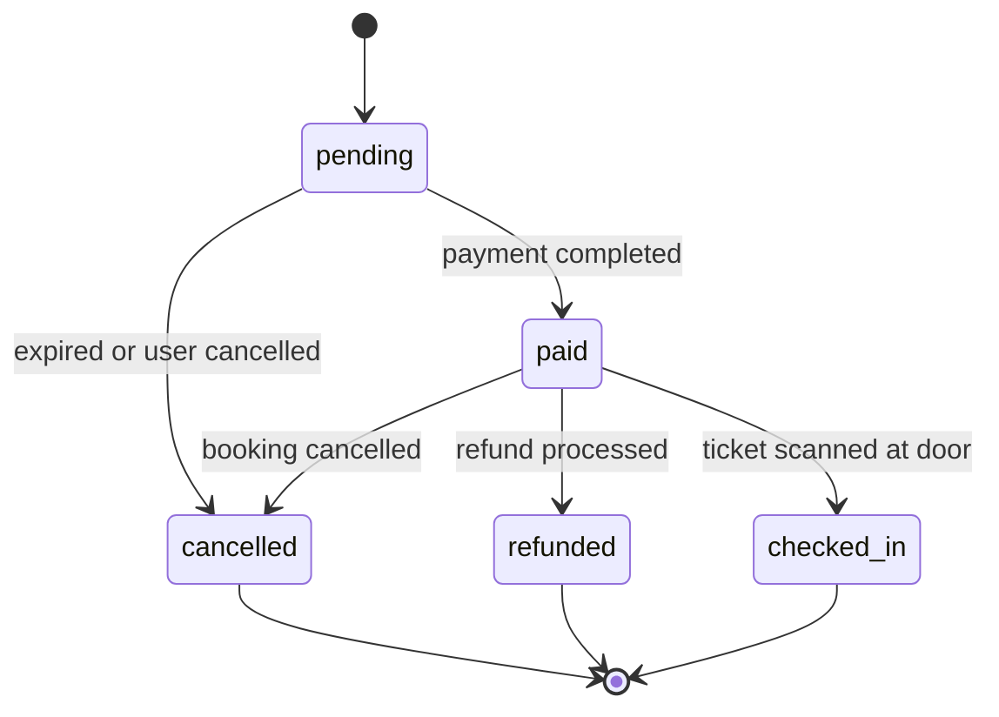

# System Architecture: Event Ticketing Platform

## 1. Architectural Layers

The system follows a strict layered architecture where dependencies point only downwards. Nothing may call upwards.

### Layer Responsibilities and Constraints

- **HTTP Routes**: May parse incoming HTTP requests, decode parameters, and serialize JSON or HTML responses; may not execute business rules or interact directly with the database.
- **Services**: May orchestrate multi-step business workflows, coordinate domain rules, and call repositories; may not depend on HTTP request/response primitives or call back to routes.
- **Domain Rules**: May validate entity state transitions, enforce core ticketing rules, and operate as pure logic in memory; may not execute network/disk I/O or depend on repositories or services.
- **Repositories**: May perform CRUD queries and atomic transactions against SQLite/memory; may not make domain business decisions or call services or routes.
- **Data Store**: May persist structured records and enforce schema constraints; may not initiate calls to application layers.

---

## 2. Data Model

The domain consists of four primary entities: `USERS`, `EVENTS`, `TICKET_TIERS`, and `BOOKINGS`.

---

## 3. Booking Life Cycle

The booking status progresses through an explicit finite state machine. `cancelled`, `refunded`, and `checked_in` are terminal states.

